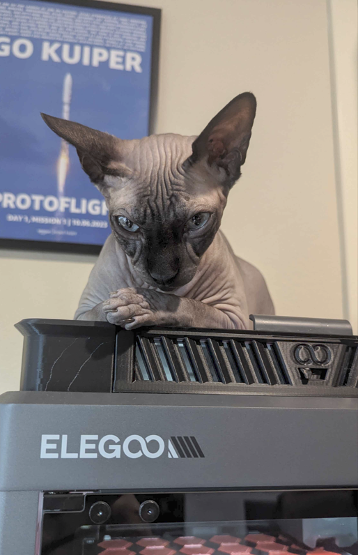

# videobingus



Offline procedural video compositions for DJ mixes. Python, FFmpeg, generative artwork, and optional footage.

Generate seeded edits, layer footage, apply analog and digital effects, and respond to track changes or audio energy. Rendering runs locally on the CPU. Source footage stays untouched; your mix supplies the soundtrack.

## Install

Requires Python 3.12+ and [uv](https://docs.astral.sh/uv/getting-started/installation/). Install uv separately using its official instructions, then install FFmpeg:

Windows (PowerShell):

```powershell
winget install --id Gyan.FFmpeg -e
```

Ubuntu:

```bash
sudo apt install ffmpeg
```

In this repository, on either platform:

```text
uv sync --locked
uv run videobingus doctor
```

Reopen your terminal after installing FFmpeg if it is not found. Explicit `ffmpeg` and `ffprobe` executable paths can also be set in YAML. The application never installs system tools.

## Use

```text
uv run videobingus render mix.wav footage/ -o mix.mp4
uv run videobingus render mix.flac --suite demoscene --seed 420 -o generated.mp4
uv run videobingus render mix.flac footage/ --suite acid_television -o hybrid.mp4
uv run videobingus render mix.wav footage/ --preset vhs --seed 420 --cue mix.cue -o mix.mp4
uv run videobingus render --config project.yaml
uv run videobingus preview --config project.yaml --start 12:30 --duration 30 -o preview.mp4
uv run videobingus plan --config project.yaml -o plan.json
uv run videobingus render --plan plan.json
uv run videobingus validate project.yaml
uv run videobingus effects list
uv run videobingus effects demo optical_feedback --input footage.mp4 --param gain=1.02 --duration 15 -o feedback.mp4
uv run videobingus effects demo dirty_crossfade --input a.mp4 --second-input b.mp4 -o transition.mp4
uv run videobingus presets list
uv run videobingus presets demo modular_video -o modular-demo.mp4
```

Multiple footage directories or individual videos can follow the audio argument. Defaults are 1080p, 30 fps, H.264 CRF 20, and AAC audio; compatible AAC, MP3, and ALAC soundtracks are copied. Existing output requires `--overwrite`. Use `--help` on any command for options.

Output defaults to YouTube-shaped **1920×1080**, preserving source aspect ratio with black bars. Use `--resolution 1920x1080 --fit stretch` to fill the frame by stretching, or `--fit crop` to fill it by cropping.

Suites choose compatible generators, palettes, effects, transitions, and audio responses within fixed budgets. They support footage-only, fully generated, and hybrid compositions. Start with `demoscene`, `artificial_life`, `acid_television`, `digital_decay`, or `bass_mutations`. Run `suites list` for all eleven aesthetics.

```text
uv run videobingus generators demo reaction_diffusion --duration 30 -o organisms.mp4
uv run videobingus suites demo demoscene --showcase --duration 30 --contact-sheet preview.png -o showcase.mp4
uv run videobingus suites compile artificial_life mix.flac --seed 420 -o project.yaml
uv run videobingus suites generate --theme organic --audio-reactive --seed 42 -o my-suite.yaml
```

The [generative guide](docs/generative.md) covers custom suites, generators, palettes, modulation, quality settings, and reproducible plans.

Presets: `clean`, `vhs`, `destroyed_vhs`, `corporate_training`, `digital_glitch`, `psychedelic`, `crt_camcorder`, and `bass_reactive`. Their [YAML files](src/videobingus/presets) are editable and use the project schema.

Synthesis presets add `circuit_bent`, `dirty_mixer`, `optical_feedback`, `optical_feedback_aggressive`, `modular_video`, `raster_bender`, `composite_failure`, `feedback_broadcast`, `datamosh`, `hybrid_glitch`, and `audio_patch`. These combine delayed display/camera feedback, A/B mixers, luma/chroma signal processing, spatial oscillators, scopes, and motion-compensated simulated datamoshing. See the [synthesis guide](docs/synthesis.md) for configuration, research references, parameter ranges, and limitations.

## Project configuration

```yaml
seed: 420
audio: ./mix.wav
sources: [./footage]
preset: vhs
output:
  path: ./mix.mp4
  resolution: [1920, 1080]
  fps: 30                     # Also accepts "30000/1001".
  fit: fit                    # fit, crop, stretch
clips:
  duration: [3, 15]
  speed: [0.9, 1.1]
effects:
  per_clip:
    - id: mirror
      type: mirror
      probability: 0.15
```

Paths are relative to the YAML file. Nested mappings merge in order: defaults, preset, project, track overrides, CLI overrides. Lists replace the corresponding list; they do not append or merge by ID. Unknown fields and effect parameters fail validation. See [architecture and configuration](docs/architecture.md) for layers, scheduling, audio modulation, titles, and operating limits.

For a local demo using the supplied footage and a **synthetic test soundtrack**:

```text
uv run python examples/make_demo.py
uv run videobingus preview --config examples/project.yaml --duration 10 -o .output/demo.mp4
```

Replace the example's audio and CUE paths with your own mix for normal use.

## Plans and previews

A seed reproduces editing decisions. Save a plan to preserve clip offsets, speeds, sampled parameters, effect events, overlays, tracks, and analysis. Unrelated effects use separate random streams. Encoder and platform differences can still change individual pixels.

Plans store paths relative to the plan file. Keep that directory structure when copying a project, or use `--media-root /new/project/root` with `render --plan` or `preview --plan`. That root substitutes for the original plan directory. Plan export requires media and the plan destination on the same drive. Machine-specific FFmpeg paths are omitted; set `--ffmpeg` and `--ffprobe` on the destination if needed.

Preview a saved plan for the same composition. A project without a seed gets a fresh seed whenever it is planned. Previews use three seconds of effect warm-up; long feedback histories can differ from a full render. Preview resolution defaults to 640×360.

Use `preview --exact-history` to process the timeline from frame zero without encoding the preceding section. This preserves temporal history at the selected preview resolution and costs proportionally more time. `--warmup` changes the approximate warm-up in seconds. Add `--profile` to render, preview, or audition commands for per-effect and per-generator timings. Effect and suite demos use synthetic stereo test audio when no audio is supplied; standalone generator demos are silent by default.

## Development

```text
uv sync --locked
uv run pytest -q
uv run ruff check src tests examples
uv run ruff format --check src tests examples
uv build
```

Tests generate their own media. GitHub Actions is configured for Windows and Ubuntu. Local rendering has been verified on Windows; Ubuntu verification depends on CI. Multi-hour performance has not yet been benchmarked.

Rendering streams frames; memory grows with resolution, active layers, and temporal effects. Start with a 640×360 preview, allow roughly 1–2 GB of RAM for modest 1080p compositions, and expect effect-heavy rendering to run below real time. Final H.264 size varies with footage; budget several GB per hour and enough space for the completed output while an existing output remains in place.
